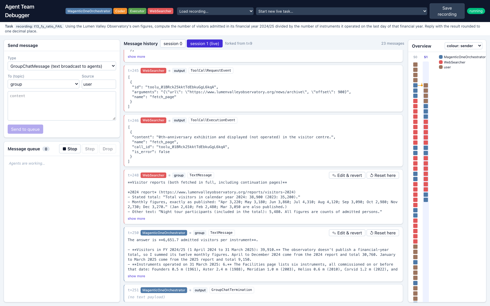

## 1. Team members

| Name | Email |
|---|---|
| Nguyen Nhat Minh | nm.nguyen.2026@phdcs.smu.edu.sg |
| Do Duc Anh | doducanh.2026@phdcs.smu.edu.sg |

## 2. Selected paper

Epperson, Bansal, Dibia, Fourney, Gerrits, Zhu and Amershi. 2025. *Interactive Debugging and Steering of Multi-Agent AI Systems*. CHI '25, Yokohama. ACM. https://doi.org/10.1145/3706598.3713581. Reference code: github.com/microsoft/agdebugger (MIT).

## 3. Current progress and implemented components

Own implementation (about 900 lines of Python, 500 of TypeScript) on AutoGen 0.7.5; the reference code was consulted only for its runtime hook. The team under debug is a Magentic-One orchestrator with a **Coder**, a **local code Executor** and a **WebSearcher** with two web modes per task: a cached 30-page corpus and live Wikipedia (search plus plain-text extracts read in 3,000-character chunks).

**Substrate — instrumented runtime with checkpoints (fully implemented).** An `InterventionHandler` intercepts every send, publish and RPC response, assigns a global timestamp and calls `runtime.save_state()` *before* the message is processed, so every agent's context can be restored at any timestamp. Runs are saved as recordings and replay without model calls.

**C1 — Message history, sending and execution control (fully implemented).** Cards show sender, recipient or topic, type and payload, tool calls included. The compose panel sends a broadcast, a direct request-to-speak, or a new task; the queue panel offers *Run*, *Stop*, *Step* (one message) and *Drop*.

**C2 — Reset-and-edit with session forking (fully implemented).** *Edit & revert* and *Reset here* stop the runtime, clear the queue, snapshot the session, restore the checkpoint taken before that timestamp, re-publish the (edited) message with the rest of the burst its handler emitted (the orchestrator's follow-up request-to-speak) and continue in a new session; earlier branches stay viewable via session tabs. Two details the paper leaves open: the burst replay, and writing the edit into the sender's own saved state (message thread, and the orchestrator's stored facts and plan) — otherwise the orchestrator keeps acting on the text it remembers. *Simplified:* edits are text-level, not arbitrary JSON; queue editing and E1 are not implemented yet.

**C3 — Overview visualisation (implemented, basic).** One column per session, one rectangle per message, forks drawn from the replaced message in the parent column, three colour encodings with a legend filter, hover details and click-to-scroll. *Simplified:* plain SVG with D3 scales, no zooming.

**Harness (partly done).** 29 tasks with verified ground truth: 13 over the corpus (stale, conflicting or near-duplicate sources; date arithmetic; two coding tasks) and 16 GAIA-style Wikipedia questions, five answerable only from tables. A harvest script runs each task repeatedly and grades the answer. **Finding:** Claude Opus 5.5 was correct in 97 of 97 runs at default and low effort — none of the paper's failure modes appeared. Claude Haiku 5.5 at low effort fails naturally — 4 of 84 runs: three 228–235-message stalls on the financial-year task and one 224-message stall on a Wikipedia table question — so the team under debug is Haiku, as the paper's was the then-current GPT-4o. The recorded failure in the video (`t13_fy_ratio_FAIL`, 228 messages): the orchestrator's plan assumes a published financial-year total and forbids estimating; the searcher finds the monthly tables but reports "not found"; the orchestrator re-plans 22 times and gives up. Editing the plan message steers the same team to the answer in 23 messages.

**Technical challenges.** (1) AutoGen's Anthropic client crashed on the current SDK; our replacement also replays reasoning blocks with tool calls. (2) Claude rejects replayed reasoning once the conversation prefix changes — exactly what reset-and-edit does — so the client asks the API to drop stale blocks. (3) In AutoGen's tool-reflection step (no tools in the request) the model answered with reasoning only; the client now renders earlier tool calls as text. (4) Two "failures" were ours: a wrong ground truth (Kipling, born in Bombay, 1907 Nobel) and a grader that missed "four" for 4; every answer is now checked against the live page.

## 4. Prototype fidelity assessment

- *Interface vs intended design:* the paper's panels and interactions are present and work on real runs; styling is simpler.
- *Component behaviour:* real — genuine AutoGen runtime, checkpoints, live model calls, code execution; no Wizard-of-Oz.
- *Data realism:* the corpus is synthetic (a fictional observatory); the Wikipedia tasks are real. The failing run is a natural failure of the full team, not scripted or weakened.
- *Integration:* end to end (load recording, browse, overview-click, edit, step, run, fork).

## 5. System architecture

Backend: Python 3.12, FastAPI, AutoGen 0.7.5 (`MagenticOneGroupChat`, `CodeExecutorAgent`, `AssistantAgent`), Anthropic SDK 1.14 (`claude-haiku-5-5` under debug, `claude-opus-5-5` for the comparison). Frontend: React 19, TypeScript, Vite, Tailwind 4, D3 scales; the UI polls `/api/state` every 0.7 s. External services: the Claude API and the MediaWiki API.

## 6. Implementation roadmap

- **Week 10:** finish the failing-run set (four to five Haiku runs, each with a coded ground-truth error list); queue editing; UI polish.
- **Weeks 10–11:** E1 — an LLM-as-judge pass returning ranked suspect messages, suspect markers in the overview, and a context panel (flagged message, sender–recipient chain, preceding tool calls) that pre-fills the edit box.
- **Week 11:** study instruments (paper's Appendix A/B), reduced-condition flag (no reset, no overview); pilot.
- **Weeks 12–16:** study, analysis, presentation, report; E2 only if E1 lands by Week 11.

## 7. Updated evaluation plan

Unchanged from the proposal (Part 1 n=6 error identification, reduced / full / full+E1 on recorded failures; Part 2 n=8 live steering with Likert ratings and edit coding), with one consequence of the harvest: the team under study runs Claude Haiku 5.5, since the Opus team gave nothing to identify or steer; the final report will discuss this contrast.
